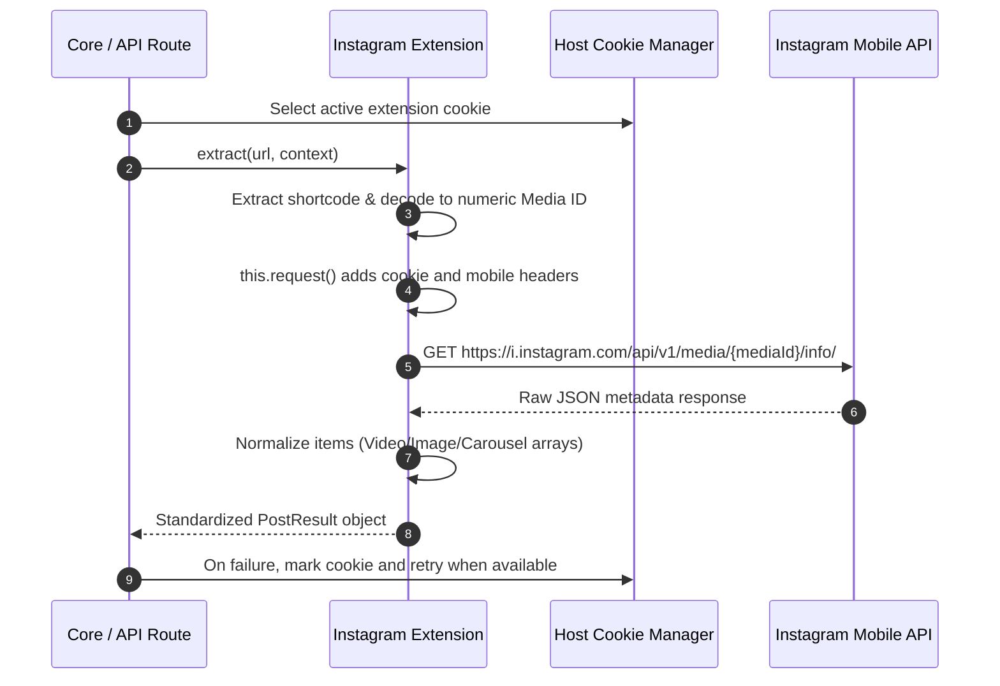

# Instagram Extension: Technical & Fetching Mechanism

This document describes how the Instagram extension extracts posts, Reels, Stories, and carousels through Instagram's mobile API.

---

## 1. Core Extraction Strategy

The extension decodes post shortcodes into media IDs and calls Instagram's mobile API using the host-provided request and cookie interfaces. The extension itself does not access the database or manage cookie rotation.

### Key Components:
- **Manifest (`manifest.ts`)**: Defines platform metadata, ID, name, and URL regex patterns for matching supported Instagram links.
- **Handler (`index.ts`)**: Implements shortcode decoding, mobile API calls, response normalization, and error handling.
- **Host cookie handling**: The host selects an active cookie for this extension and supplies it through `ExtensionContext.getCookie()`. If extraction fails, the host may retry with another active cookie. This rotation is implemented in the host, not in this extension.
- **Network handling**: Requests go through `this.request()` and the host-provided `ExtensionContext.fetch`; the host owns network defenses such as FlareSolverr.

---

## 2. Extraction Workflow



---

## 3. Implementation Details

### A. Shortcode Decoder
Instagram post URLs use string-based shortcodes (e.g., `https://www.instagram.com/p/DfE10UGkgvA/`). These are decoded into numeric media IDs using a Base64 variant lookup algorithm:

```ts
function decodeShortcode(shortcode: string) {
  const alphabet = "ABCDEFGHIJKLMNOPQRSTUVWXYZabcdefghijklmnopqrstuvwxyz0123456789-_";
  let id = BigInt(0);
  for (let i = 0; i < shortcode.length; i++) {
    id = (id * BigInt(64)) + BigInt(alphabet.indexOf(shortcode[i]));
  }
  return id.toString();
}
```

### B. Mobile API Endpoint & Headers
- **Endpoint**: `https://i.instagram.com/api/v1/media/{mediaId}/info/`
- **User-Agent**: Mimics the official Instagram mobile app (`Instagram 290.0.0.21.111 ...`).
- **Headers**: The extension supplies an Instagram mobile user-agent and `X-IG-App-ID`. `BaseExtension.request()` attaches the Netscape-format cookie provided by the host when one is available. The host manages cookie selection and retries.
