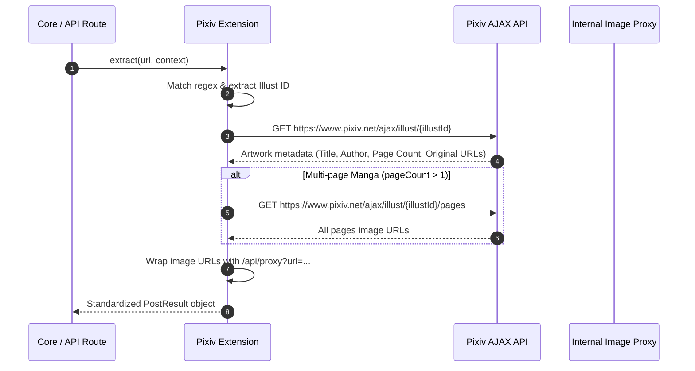

# Pixiv Extension: Artwork & Manga Ingestion

This document details the architecture and fetching mechanics of the **Pixiv** extension in **MediaDL**.

---

## 1. Core Extraction Strategy

The Pixiv extension uses Pixiv's AJAX JSON endpoints to extract illustrations, multi-page manga, and high-resolution original artwork URLs.

### Key Components:
- **Manifest (`manifest.ts`)**: Defines Pixiv platform metadata, unique ID, name, and URL regex patterns (`pixiv.net/artworks/{id}`).
- **Handler (`index.ts`)**: Parses artwork IDs from URLs, queries Pixiv AJAX endpoints (`/ajax/illust/{id}` and `/pages`), and handles multi-page gallery iteration.
- **Referer & Image Proxy (`/api/proxy`)**: Requests to Pixiv use `Referer: https://www.pixiv.net/`. The extension rewrites thumbnail and media URLs to the host's `/api/proxy` route; the host proxy checks that the image domain belongs to an enabled extension and sets its configured image referer.

---

## 2. Extraction Workflow



---

## 3. Implementation Details

### A. Artwork ID Parsing
Extracts numerical IDs from Pixiv artwork URLs:
```ts
const match = url.match(/artworks\/([0-9]+)/i);
const illustId = match ? match[1] : null;
```

### B. Hotlink Protection & Request Headers
The extension sends Pixiv-specific request headers, including:
- **Referer**: `https://www.pixiv.net/` (sent with Pixiv API requests and configured for proxied image requests).
- **User-Agent**: Standard desktop browser user-agent string.
- **Proxy Routing**: Resulting image URLs are rewritten as `/api/proxy?url=...` for host-side fetching and delivery to the frontend.
